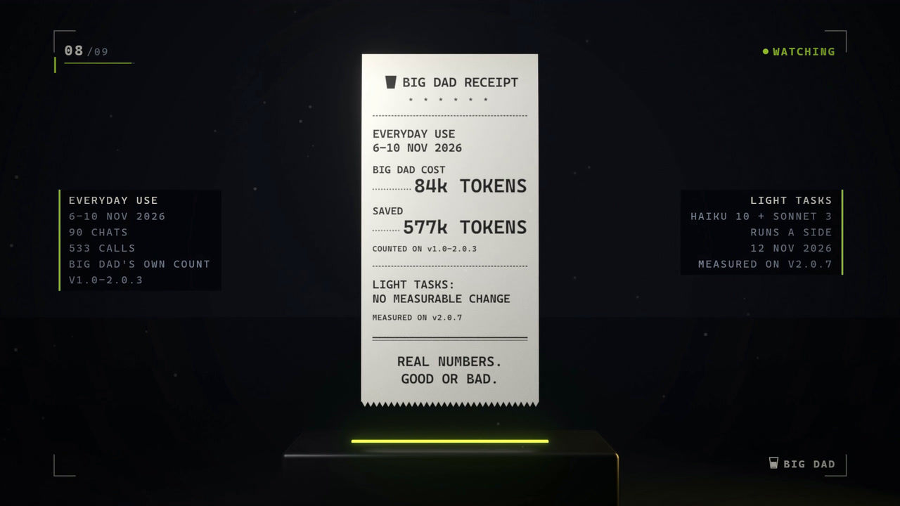

<p align="center">
  
</p>

<h1 align="center">🥛 Big Dad</h1>

<p align="center">
  The token watchdog for Claude Code<br>
  Plugin version 2.0.9 · MIT · Windows, macOS, Linux
</p>

## Watch the ad

https://github.com/user-attachments/assets/1021fd70-1975-4621-9497-18a5dfa49e3c

<p align="center">
  
</p>

## What it is

> Dad went out for milk. He never came home.<br>
> **Big Dad's home.** I'm your token watchdog. I brought the milk.

Every time you hit enter, Claude Code sends the whole conversation again. Big Dad is a Claude Code plugin that watches what each call re-sends, stops a second read of a file that is already in context, trims noisy output and slims the compact. It changes no setting without your yes. It runs on your machine, uses the Python standard library only and has no telemetry.

<p align="center">
  
</p>

## Install

```
claude plugin marketplace add louievika/lab
claude plugin install bigdad@lab
```

Then start a new Claude Code session and say `big dad`.

Needs Python 3 (3.9 or newer). Update: `claude plugin update bigdad@lab`. Remove: `claude plugin uninstall bigdad@lab`.

## What it does

<p align="center">
  
</p>

| | |
|---|---|
| **Watch** | Every call and every helper agent: what is re-sent, what loads at startup, which agents grow. |
| **Block** | A second read of an unchanged file that is still in context is stopped. Big, noisy command output is cut before it enters the chat; the full output is kept in a file. Before a compact, the summary is told what is dead weight. |
| **Your yes** | No setting changes without it. Every cut is backed up first and can be undone. Big Dad never deletes a skill, plugin or file of yours. |

Type `receipt` in any chat for that chat's receipt, read from its own log. It costs 0 tokens: the prompt never reaches the model.

## Measured results

<p align="center">
  
</p>

| Case | Model | Runs | Without Big Dad | With Big Dad | Change |
|---|---|---|---|---|---|
| Same file read 3 times | Haiku | 10 a side | $0.0095 | $0.0048 | -49.4% |
| Same file read 3 times | Sonnet | 3 a side | $0.1745 | $0.0819 | -53.1% |
| Four-task set | Haiku | 5 a side | $0.0194 | $0.0160 | -17.5% |

Dollars per run, median, by Claude Code's own cost figure (not a bill). Measured on v2.0.7 on 12 Nov 2026. The first two rows come from a 7-case bench of 182 headless runs (Haiku 70 + 70, Sonnet 21 + 21), a fresh profile for every run. The four-task set was a separate run on the same day; its two run ranges do not touch.

<p align="center">
  
</p>

Everyday use, 6-10 Nov 2026 (90 chats, Big Dad's own count, versions 1.0 to 2.0.3): Big Dad cost 84k tokens and saved 577k.

Slim compacts in live use, 8 to 10 Nov 2026: 12 compacts, tokens per call summed 2.17M to 0.75M (-65%), about 118k smaller per later call. Big Dad's own count, the receipt covers versions 1.0 to 2.0.3; not multiplied by later calls and not in the totals.

<p align="center">
  
</p>

End-to-end loop, 12 Nov 2026: Big Dad 2.0.6 against 2.0.7, installed as a real plugin in headless Claude Code, 26 live runs (Haiku 12, Sonnet 14). Every scenario passed on both sides except one, partial on both: the report rule "one line per finding". One run per scenario per side. Limits: profiles were not isolated from the account's synced plugins; Windows only, Linux and macOS not run.

Early head-to-head runs, 8 Nov 2026 (Big Dad development builds from 8 Nov 2026, before 1.5.0, Haiku, 3 runs a side, median input per run): v1 360k to 352k (-2%), 3 of 3 correct without and 0 of 3 with (a Big Dad bug, fixed in 1.5.0); v2 411k to 320k (-22%), 2 of 3 and 2 of 3; v3 462k to 320k (-31%), 1 of 3 and 3 of 3; long run 961k to 472k (-51%), 0 of 3 and 3 of 3. Cost per run (Claude Code's own cost figure, not a bill): v1 $0.0336 to $0.0181, v2 $0.0470 to $0.0181, v3 $0.0475 to $0.0181. Old versions, 3 runs a side, the guide set to 20k so the notes fire, one PC.

### What it does not do

- **Light tasks:** the median showed no change (tokens Haiku +0.2%, Sonnet -0.1%), but the mean was higher with Big Dad (tokens +5.3% Haiku, +16.1% Sonnet; dollars +1.5% and +5.9%). The run ranges overlap, so this may be noise. Big Dad stayed silent in this case. 2.0.7, 12 Nov 2026; 10 runs a side on Haiku, 3 on Sonnet.
- **Helper agents:** the helper-agent case cost about 7% more dollars with Big Dad (Haiku +7.0%, Sonnet +7.2%, median; the run ranges overlap).
- **Whole suite on Haiku:** all 7 cases added up came out -9.0% in dollars, but the run ranges overlap, so the difference is inside the noise.
- **Noisy output:** that case came out even; the output shrink did not fire in that test.
- **Output on the re-read case:** in the 4-task set (Haiku, 5 runs a side, 2.0.7, 12 Nov 2026) that case produced 767 output tokens with Big Dad against 318 with nothing installed (+141.2%, run ranges apart). Dollars on the same case fell from $0.0091 to $0.0067 (-26.9%).
- **Big Dad's own cost, 6-10 Nov 2026:** counting the chats that built and tested Big Dad, it cost 1,562,688 tokens and saved 1,184,194: net -378,494 tokens. Building and testing alone: net -871,400. Everyday use alone: cost 84,144, saved 577,050. Big Dad's own count, versions 1.0 to 2.0.3.
- No saving is claimed for helper agents. Compacts: see the live-use count above; in the 7-case bench the compact case showed no measurable change (the run ranges overlap).
- Limits of the bench: scripted cases, not real work; one Windows PC; Haiku and Sonnet only, no Opus.

## Check the numbers yourself

- Type `receipt` in a chat. It reads that chat's own log: input split into cache reads, cache writes and new tokens, plus output.
- Say `big dad` for the audit. Every number it shows is labelled verified, estimated or not measured.
- Run the read-guard test on your own account. It runs short headless Claude Code sessions, the same file read twice, guard off and on:

  ```
  sh bigdad/skills/bigdad/scripts/bigdad.sh proof read --model haiku
  ```

  (from a clone of this repo; it spends a little of your own usage).

<!-- GATES-2.0.9 -->
Fuzz test: 4,806 runs, 0 failures. Break test: 1,251 runs, 0 failures. Unit tests: 708 pass, 10 skipped. Linux sandbox, 2.0.9, 14 Nov 2026.
<!-- /GATES-2.0.9 -->

## Version and licence

Big Dad 2.0.9 · MIT · by LouieVika

<p align="center">
  
</p>

<p align="center"><b>Built in silence, worn in gold. One of one. One and done.</b></p>
